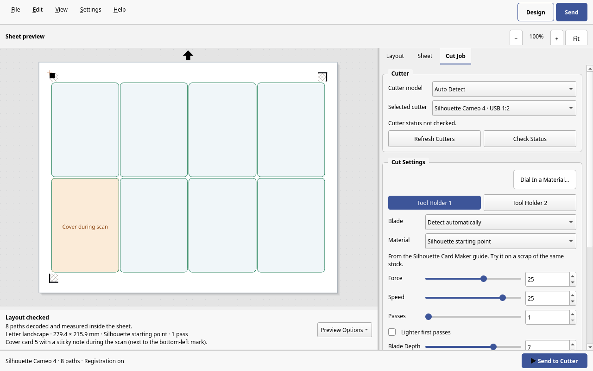
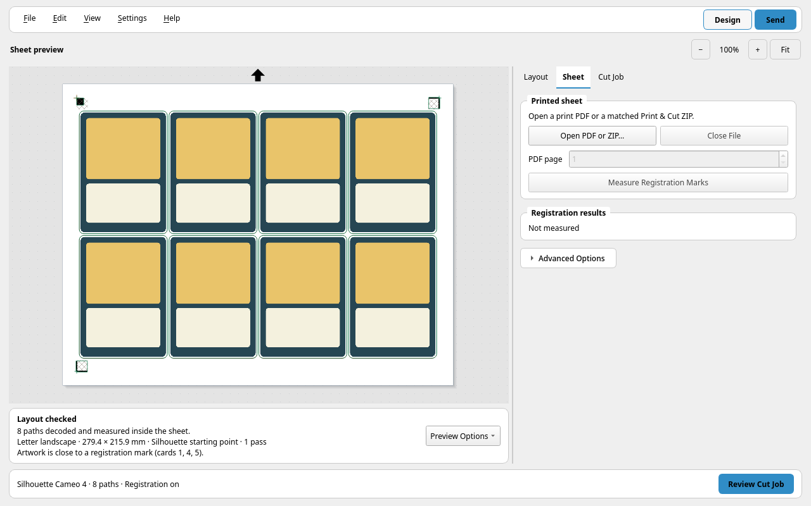

# Cutline

Design, print and cut with your Silhouette cutter on Linux.

Cutline lets you draw or import a design, print it with registration marks, and
send it to a Silhouette Cameo over USB, all without Silhouette Studio.
Before the cutter moves, Cutline reads the job back and checks every cut line
lands where it should. If something is off, it tells you and doesn't send.


## What you can do

- **Design cut files.** Draw shapes, type text in any installed font, set
  text along a curve, edit points, weld and subtract shapes, and repeat them
  in rows and columns.
- **Print & Cut.** Place a picture, trace its outline, and print it with
  registration marks. The cutter finds the marks and cuts around your print.
- **Open what you already have.** SVG, DXF, Silhouette `.studio3` files,
  Inkscape Silhouette layouts and Silhouette Card Maker templates.
- **Find the right blade settings.** Cut a small test shape, check it, and
  repeat until it's clean. Cutline remembers what worked.
- **Cut cards and stickers in bulk.** Ready-made Letter and A4 layouts for
  trading cards, plus sticker sheets from your own artwork.



## Install

Download the latest AppImage or Flatpak from the
[Releases page](https://github.com/zoro11031/silhouette-cameo-linux/releases),
then run the installer that comes with it:

```sh
sh install-silverblue.sh --appimage    # or --flatpak
sh install-silverblue.sh --udev        # once: lets Cutline talk to the cutter over USB
```

Cutline appears in your application menu. Plug the cutter in after the second
step.

Arch users can build the package in `packaging/aur/`.

## Your first cut

1. **Design** something, or choose **File → Open** to bring in a cut file.
2. Switch to **Send**. Cutline finds a connected cutter on its own.
3. Pick your **Material**. For a new material, choose **Dial In a Material**
   and cut a test shape on a scrap first.
4. Load the mat and choose **Send to Cutter**.

For Print & Cut, print the sheet at **100% / Actual size**, load it face-up
in the top-left corner of the mat, and choose **Test Registration** before
the real cut.



## Tips

- **Cards near the corner marks** can confuse the cutter's scan. Cutline points
  them out; cover them with a sticky note during the scan.
- **Cut lands slightly off everywhere by the same amount?** Trace a sheet
  with the Sketch Pen, measure how far off it is, and enter that under
  **Send → Advanced Options → Calibration**. If the error grows across the
  page, the print was scaled; check your printer's settings first.
- **Want Silhouette's full material list?** Choose **Materials → Import CSV**
  and pick `condition.csv` from a Silhouette Studio installation.
- **Two tools at once.** Assign shapes to **Tool Holder 1** or **2** under
  **Object → Tool Holder**, and Cutline sends each to the right one.
- **Something went wrong?** **Help → Troubleshoot a Cut** has checks for
  marks that won't scan, foil glare, angled or misplaced cuts, rough edges,
  a chipped coating, leftover fibers, a skipping carriage, Track Enhancing and
  laminate, each with a button to the controls it refers to. For coated, core
  and foil stock, try **Lighter first passes** under Passes. It is adapted from the Silhouette Card Maker
  [cutting guide](https://alan-cha.github.io/silhouette-card-maker/tutorial/guide/)
  and [troubleshooting](https://alan-cha.github.io/silhouette-card-maker/tutorial/troubleshooting/) pages.

## Supported cutters

Built and tested with a Silhouette Cameo 4 over USB. Cutline also knows the
other Cameo models (1 to 5, including Plus, Pro and Alpha) and the Portrait 1
to 4, but those have not been tried on real hardware.

Bluetooth: turn the cutter on and open **Send**. On Linux, Cutline finds a
cutter that has never been paired and pairs it when you choose it, as
Silhouette Studio does; on other systems, pair it in the system's Bluetooth
settings first. A Cameo 4 connects over Bluetooth Classic, as it does with
Studio, and Cutline reads its status and tools that way; cutting over
Bluetooth has not been tried yet. Bluetooth LE is experimental.

## How it works

The [documentation](docs/README.md) explains how Cutline builds and checks
each job, and how what it knows about Silhouette's cutters and Silhouette
Studio was worked out.

---

Cutline is an independent project. It is not made by, affiliated with, or
endorsed by Silhouette America. Silhouette, Cameo and Silhouette Studio are
their trademarks, used here only to say which machines Cutline works with.

Licensed under the [GNU GPL v3](LICENSE).

<details>
<summary><strong>Advanced: run from source, the command line, and USB permissions</strong></summary>

### Run from a checkout

```sh
./bin/cutline gui              # Qt is tried first; add --frontend gtk for GTK
./install.sh                # add the command, launcher and icon for your user
```

Cutline needs Python 3.10 or newer and either PySide6 (Qt) or GTK 4,
libadwaita, PyGObject and pycairo (GTK). Shape editing uses GEOS 3.10+,
text uses Pango and Cairo, and checking a printed PDF uses Pillow and
Poppler. Install PyUSB to drive the cutter, and Bleak for Bluetooth LE.

### USB permissions by hand

Add these lines to `/etc/udev/rules.d/99-silhouette.rules` (the second line
covers the Cameo 5 Alpha):

```udev
SUBSYSTEM=="usb", ATTR{idVendor}=="0b4d", MODE="0664", TAG+="uaccess"
SUBSYSTEM=="usb", ATTR{idVendor}=="3844", MODE="0664", TAG+="uaccess"
```

Then run `sudo udevadm control --reload-rules && sudo udevadm trigger` and
reconnect the cutter. If it reports the interface as busy, the kernel's
printer driver may hold it: `sudo modprobe -r usblp`.

### Command line

| To do this | Run |
|---|---|
| Check the cutter | `cutline status` |
| Check a job without moving the cutter | `cutline cut --from design.svg --dry-run` |
| Check a printed PDF's marks | `cutline check-sheet printed.pdf` |
| Cut a test-settings grid | `cutline testcut --force 25,29,33 --passes 1,2,3` |
| Print layout for an eight-card sheet | `cutline print-settings` |

`cutline --help` lists everything.

### Where things are kept

Settings and presets live in `~/.config/cutline` (override with `CUTLINE_CONFIG`),
exports in `~/Documents/Cutline` (`CUTLINE_TEMPLATES`). A preset is a JSON file in
`~/.config/cutline/presets/`; copy it to another machine to share it.

### Tests

```sh
./run-tests.sh
```

Fast and offline; cutter connections are simulated.

</details>
