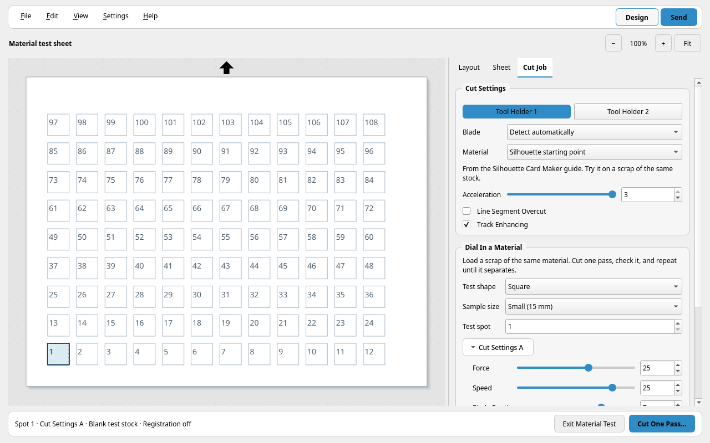
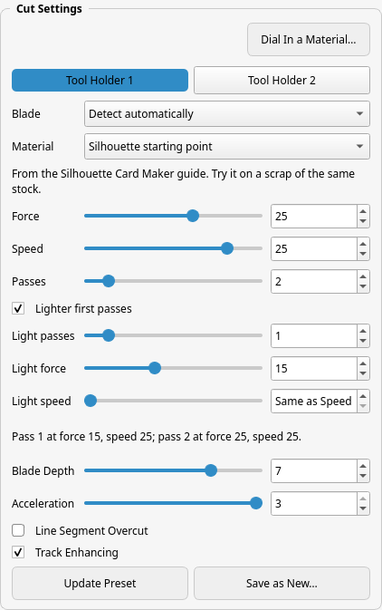

# Cutline

I built Cutline to cut my Magic: The Gathering proxies on Linux with a
Silhouette Cameo 4. I added the design tools so my wife could use it for her
own projects. It's a hobby project, and I'm sharing it so others can use it too.


## What you can do

- Lay out eight proxies on a Letter or A4 sheet and cut them after printing.
- Make stickers, gift tags, or other designs with your own artwork, shapes, and
  text.
- Open a design you already have, including SVG, DXF, and Silhouette Studio
  files.


## Cut settings

### Dial In a Material

- Pick a test shape and size, then try one pass at a time.
- See which settings you used for each pass at each test spot, and save the
  settings that work.



### Lighter first passes

- Start with gentler passes and finish at your regular cut settings.
- Choose how many passes run lighter, with separate force and speed settings
  for those passes.



## Getting started

Download the AppImage, Flatpak, or experimental Windows installer.
[GitHub Releases](https://github.com/zoro11031/cutline/releases)

On Windows, run the first update-enabled Setup over your existing installation.
For later updates, choose **Help → Check for Updates…** in Cutline. Download
the update, then choose **Quit and Run Setup** when you are ready to install.

If Cutline can't access your cutter over USB on Linux, run this once and
reconnect the cutter:

```sh
sh install-cutline.sh --udev
```

Open Cutline, create or open a design, then switch to **Send** and pick your
material. For Print & Cut, print at **Actual size (100%)** and choose
**Test Registration** before cutting.

## Cutter support

I've only tested Cutline with my Cameo 4 over USB and Bluetooth.
Your mileage may vary with other cutters.

Cutline already handles everyday design, Print & Cut registration, and
multi-pass cutting on a Cameo 4 over USB and Bluetooth, though some
Silhouette Studio effects and other cutter models are still missing or
untested. See the [Silhouette Studio parity chart](docs/studio-parity.md)
(79.0% parity) for the full breakdown.

## Thanks

Thanks to Alan Cha for the card layouts and cutting guides, and to the
Discord community for sharing what works.
[Silhouette Card Maker](https://alan-cha.github.io/silhouette-card-maker/) ·
[Silhouette Card Makers Discord](https://discord.gg/jhsKmAgbXc)

Cutline is an independent project, unaffiliated with Silhouette America.
It's licensed under the [GNU GPL v3](LICENSE).
