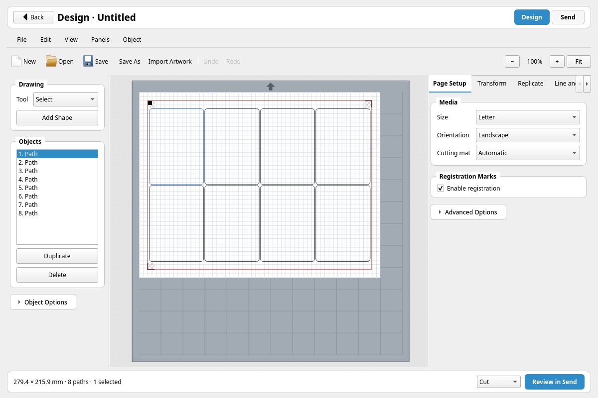

# Cutline

Design, print and cut with your Silhouette cutter on Linux.

You draw or import a design in Cutline, print it with registration marks and
send it to a Silhouette Cameo over USB or Bluetooth. You don't need Silhouette
Studio. Before the cutter moves, Cutline decodes the job it built and checks
that every cut lands where it should; if one doesn't, it says which check
failed and doesn't send anything.



## What you can do

- Draw shapes, type text in any installed font or along a curve, edit points,
  weld and subtract shapes, and repeat them in rows and columns.
- Place a picture, trace its outline and print it with registration marks.
  The cutter finds the marks and cuts around the print.
- Open SVG, DXF and Silhouette `.studio3` files, Inkscape Silhouette layouts
  and Silhouette Card Maker templates.
- Cut a small test shape on a scrap and repeat it until it comes out clean,
  or compare two settings side by side. Cutline keeps the settings that
  worked.
- Lay out trading cards on Letter or A4 from ready-made templates, or make
  sticker sheets from your own artwork.


## Install

Download from the [Releases page](https://github.com/zoro11031/cutline/releases):

| System | Download |
|---|---|
| Any Linux | The AppImage or Flatpak, plus `install-cutline.sh` |
| Fedora | The `.noarch.rpm`: `sudo dnf install ./cutline-*.noarch.rpm` |
| Arch | The `.pkg.tar.zst`: `sudo pacman -U ./cutline-*.pkg.tar.zst` |
| Windows (experimental) | `Cutline-*-Setup.exe` |

For the AppImage or Flatpak, put `install-cutline.sh` in the same folder and
run:

```sh
sh install-cutline.sh --appimage    # or --flatpak
sh install-cutline.sh --udev        # once: lets Cutline talk to the cutter over USB
```

Cutline then shows up in your application menu. Plug the cutter in after the
`--udev` step.

## Your first cut

1. **Design** something, or choose **File → Open** to bring in a cut file.
2. Switch to **Send**. Cutline finds a connected cutter on its own.
3. Pick your **Material**. For a new material, choose **Dial In a Material**
   and cut a test shape on a scrap first.
4. Load the mat and choose **Send to Cutter**.

For Print & Cut, print the sheet at **100% / Actual size**, load it face-up
in the top-left corner of the mat, and choose **Test Registration** before
the real cut.


**Dial In a Material** cuts one small shape at a time, so you can repeat a
pass on the same spot until the shape comes free, or move to a fresh spot to
try other settings.


## Tips

- The card next to the bottom-left mark can be mistaken for the mark during
  the scan, so Cutline marks it in the preview. Cover it with a sticky note
  while the cutter scans, then take it off before the cut. The cards near
  the other marks almost never need it.
- If the backs of double-sided prints don't line up with the fronts, that's
  the printer, not the cut. Silhouette Card Maker's
  [alignment guide](https://alan-cha.github.io/silhouette-card-maker/docs/offset/)
  shows how to measure and correct it.
- If every cut is off by the same small amount, draw a sheet with the Sketch
  Pen and measure how far the lines miss. Enter that under
  **Send → Advanced Options → Calibration**. If the miss gets bigger toward
  the far side of the page, your printer is scaling the print, so fix that
  first.
- Cutline comes with Silhouette's material list. If you have Studio installed
  and want its copy instead, choose **Materials → Import CSV** and pick its
  `condition.csv`.
- You can use both tool holders in one job, say a blade and a pen. Put each
  shape on **Tool Holder 1** or **2** under **Object → Tool Holder**, and
  Cutline sends it to the right tool.
- Coated, core and foil card tends to chip if the first pass goes in at full
  force. Turn on **Lighter first passes** under Passes so the blade eases
  through the coating before the full-force passes.
- When a cut goes wrong, try **Help → Troubleshoot a Cut**. It covers failed
  scans, glare, cuts in the wrong place, rough edges, Track Enhancing and
  laminate, and opens the setting you need to change. A lot of it comes from
  the Silhouette Card Maker
  [troubleshooting guide](https://alan-cha.github.io/silhouette-card-maker/tutorial/troubleshooting/).

## Supported cutters

Cutline is developed against a Silhouette Cameo 4. Over USB it has cut
several registered Print & Cut sheets, with both tool holders, and the cuts
landed slightly off-centre; use the calibration tip above to correct that. Over Bluetooth it
reads the cutter's status and tools, but hasn't sent a cut that way yet. The
other Cameo models (1 to 5, including Plus, Pro and Alpha) and the Portrait 1
to 4 are supported in the code but haven't been tried on real hardware.

For Bluetooth, turn the cutter on and open **Send**. On Linux, Cutline finds a
cutter that has never been paired and pairs it when you pick it, the way
Silhouette Studio does. On other systems, pair it in the system's Bluetooth
settings first. A Cameo 4 uses Bluetooth Classic; Bluetooth LE support is
experimental.

## How it works

The [documentation](docs/README.md) covers how Cutline builds and checks each
job and how Silhouette's protocol and file formats were worked out.
[Studio parity](docs/studio-parity.md) compares Silhouette Studio's features
with Cutline's and marks each one as working, partial or missing.

---

Cutline is an independent project. It is not made by, affiliated with, or
endorsed by Silhouette America. Silhouette, Cameo and Silhouette Studio are
their trademarks, used here only to say which machines Cutline works with.

Licensed under the [GNU GPL v3](LICENSE).

<details>
<summary><strong>Running from source, USB permissions and the command line</strong></summary>

### Run from a checkout

```sh
./bin/cutline gui    # Qt is tried first; add --frontend gtk for GTK
./install.sh         # add the command, launcher and icon for your user
```

Cutline needs Python 3.10 or newer and either PySide6 (Qt) or GTK 4,
libadwaita, PyGObject and pycairo (GTK). Shape editing uses GEOS 3.10+,
text uses Pango and Cairo, and checking a printed PDF uses Pillow and
Poppler. Install PyUSB to drive the cutter, and Bleak for Bluetooth LE.

### USB permissions by hand

Add these lines to `/etc/udev/rules.d/99-silhouette.rules` (the second line
covers the Cameo 5 Alpha):

```udev
SUBSYSTEM=="usb", ATTR{idVendor}=="0b4d", MODE="0664", TAG+="uaccess"
SUBSYSTEM=="usb", ATTR{idVendor}=="3844", MODE="0664", TAG+="uaccess"
```

Then run `sudo udevadm control --reload-rules && sudo udevadm trigger` and
reconnect the cutter. If it reports the interface as busy, the kernel's
printer driver may hold it: `sudo modprobe -r usblp`.

### Command line

| To do this | Run |
|---|---|
| Check the cutter | `cutline status` |
| Check a job without moving the cutter | `cutline cut --from design.svg --dry-run` |
| Check a printed PDF's marks | `cutline check-sheet printed.pdf` |
| Cut a test-settings grid | `cutline testcut --force 25,29,33 --passes 1,2,3` |
| Print layout for an eight-card sheet | `cutline print-settings` |

`cutline --help` lists everything.

### Where things are kept

Settings and presets live in `~/.config/cutline` (override with `CUTLINE_CONFIG`),
exports in `~/Documents/Cutline` (`CUTLINE_TEMPLATES`). A preset is a JSON file in
`~/.config/cutline/presets/`; copy it to another machine to share it.

### Tests

```sh
./run-tests.sh
```

Fast and offline; cutter connections are simulated.

</details>
